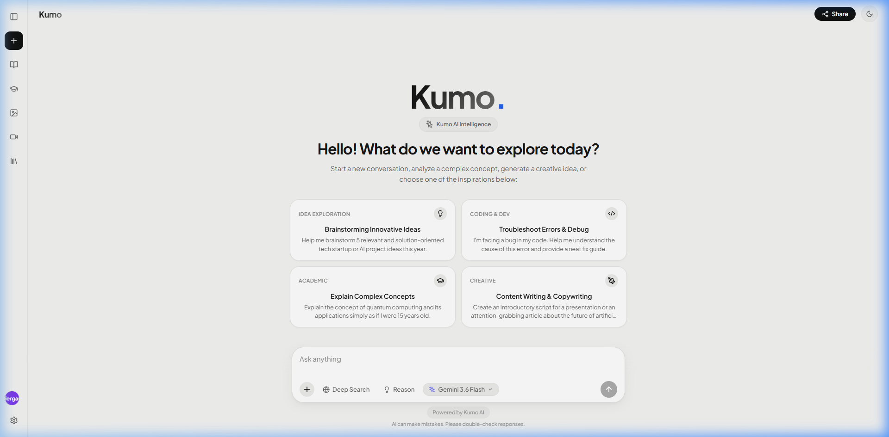
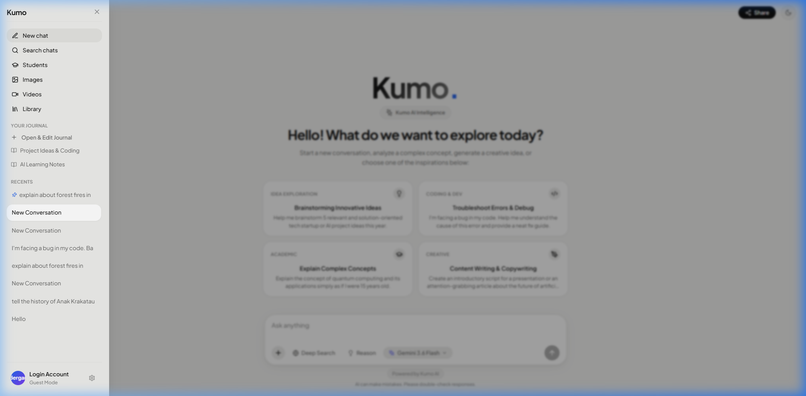
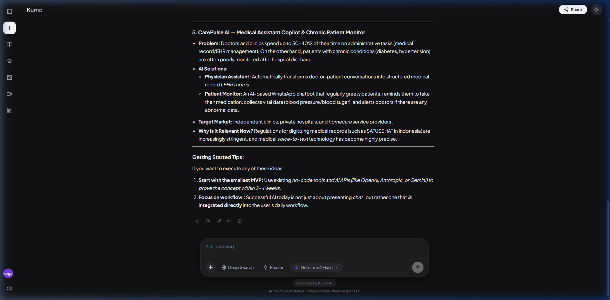
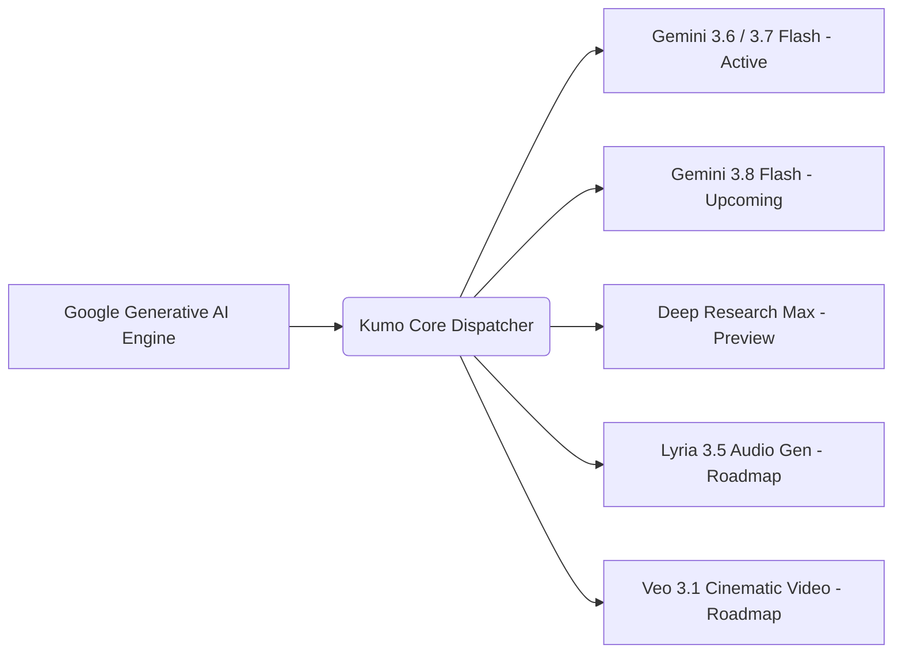

# ☁️ Kumo AI — Next-Generation Intelligent Workspace

<div align="center">



**Ruang Kerja AI Generasi Baru dengan Streaming SSE Berkecepatan Tinggi, Arsitektur Modular Mandiri, & Antarmuka Minimalis Modern.**

[](https://react.dev/)
[](https://vitejs.dev/)
[](https://ai.google.dev/)
[](https://kumo.ai)

</div>

---

## 📸 Antarmuka Pengguna & Galeri Visual (UI Showcase)

<div align="center">

| 🌟 Tampilan Utama (Home Workspace) | 📂 Navigasi Sidebar & Drawer |
| :---: | :---: |
|  |  |
| *Tampilan awal bersih dengan suggestion cards interaktif* | *Drawer sidebar dengan riwayat chat & navigasi view* |

| 🌙 Percakapan Aktif & Dark Mode |
| :---: |
|  |
| *Streaming teks kata demi kata dengan kursor dinamis & loading wave dots* |

</div>

---

## 📖 1. Tentang Kumo AI (Overview)

**Kumo AI** adalah platform *All-in-One Intelligent Workspace* modern yang dirancang untuk memadukan kecerdasan buatan (*Artificial Intelligence*) tingkat lanjut dengan pengalaman pengguna (*User Experience*) yang bersih, cepat, dan tanpa hambatan.

Kumo tidak hanya bertindak sebagai chatbot biasa, melainkan sebagai ekosistem produktivitas lengkap yang memisahkan modul-modul esensial (seperti pembelajaran siswa, perancangan visual prompt, skrip video sinematik, pustaka prompt komunitas, serta jurnal pribadi) ke dalam **arsitektur tampilan modular (*Dedicated View Architecture*)**.

### 🌟 Visi Utama:
- **Respon Alami & Mengalir**: Menghadirkan interaksi AI yang lugas, manusiawi, dan cerdas tanpa pola kalimat kaku atau frasa robotik berulang.
- **Privacy-First (Lokal Mandiri)**: Seluruh riwayat percakapan, pengaturan tema, dan data jurnal tersimpan aman secara lokal di memori pengguna (*LocalStorage*).
- **Zero Latency UI**: Desain antarmuka responsif dengan transisi mikro yang halus, loading indicator gelombang minimalis, dan kursor streaming dinamis.

---

## 🧠 2. Base AI Engine & Model Saat Ini

Kumo AI terhubung langsung ke infrastruktur resmi **Google Generative Language API (v1beta)** menggunakan transmisi data *Server-Sent Events (SSE)* untuk menghasilkan *token-by-token streaming* berkecepatan tinggi.

### ⚡ Model Aktif Saat Ini:
| Model ID | Nama Tampilan | Karakteristik Utama | Kegunaan Terbaik |
| :--- | :--- | :--- | :--- |
| `gemini-3.6-flash` | **Gemini 3.6 Flash (Default)** | Kecepatan inferensi ultra-cepat, akurasi penalaran tinggi, efisiensi token | Percakapan harian, coding cepat, eksplorasi ide |
| `gemini-3.7-flash` | **Gemini 3.7 Flash** | *Hybrid Reasoning Architecture*, penalaran komprehensif | Pemecahan masalah rumit, logika matematika |
| `gemini-flash-latest` | **Gemini Flash Latest** | Jalur pembaruan otomatis versi flash paling mutakhir | Tugas-tugas produktivitas umum yang stabil |
| `gemini-3.1-pro-preview` | **Gemini 3.1 Pro** | Kapasitas analisis mendalam & pemrosesan dokumen kompleks | Riset ilmiah, refactoring arsitektur software |

---

## 🔮 3. Roadmap & Upcoming Model AI

Kumo AI dirancang dengan abstraksi API yang siap mendukung generasi model mutakhir berikutnya:



1. **Gemini 3.8 Flash**: Peningkatan latensi mendekati nol dan pemrosesan multi-modal multimodal generasi lanjut.
2. **Deep Research Max (04-2026 Preview)**: Modul riset otonom multi-sumber yang mampu menelusuri puluhan dokumen web secara simultan.
3. **Lyria 3.5 Engine**: Pembuatan aransemen musik, akord, dan sintesis audio langsung dari prompt studio Kumo.
4. **Veo 3.1 Studio**: Generasi video generatif resolusi tinggi terintegrasi dengan modul *Videos View*.
5. **Antigravity Preview**: Mode agen otonom untuk otomatisasi alur kerja coding dan eksekusi tugas multi-langkah.

---

## 🚀 4. Fitur-Fitur Utama Platform

### A. Core Chat & Intelligence
- **Real-Time SSE Streaming**: Jawaban teks mengalir kata demi kata dengan kursor pengetikan interaktif.
- **Minimalist 3-Dot Pulse Loader**: Animasi tiga titik gelombang (*wave dots*) halus saat AI merumuskan jawaban.
- **Deep Search with Source Pills**: Integrasi pencarian web multi-sumber lengkap dengan rujukan tautan eksternal.
- **Live Reasoning Accordion**: Panel proses berpikir transparan (*Thinking Process*) yang dapat dibuka/tutup.
- **Voice Synthesis (TTS)**: Pembacaan suara jawaban otomatis dengan dukungan deteksi aksen bahasa.
- **Multi-Modal Vision Support**: Unggah file gambar (JPEG, PNG, WebP) untuk analisis diagram atau screenshot kode.

### B. Dedicated Workspace Modules (Views)
1. **🎓 Students View**: Modul belajar terpandu untuk perangkuman materi, latihan soal, dan penjelasan konsep rumit.
2. **🎨 Images Studio View**: Generator dan kurator prompt visual untuk Stable Diffusion, Midjourney, dan Imagen.
3. **🎬 Videos Studio View**: Perancang skrip adegan, angle kamera, dan storyboard sinematik.
4. **📚 Prompt Library View**: Repositori prompt siap pakai dari berbagai kategori (Coding, Bisnis, Edukasi, Desain).
5. **📓 Your Journal View**: Editor catatan & jurnal pribadi dengan integrasi tombol asisten AI.

---

## 🎨 5. Desain Antarmuka & Estetika UI

Antarmuka Kumo AI dibangun dengan prinsip **Aesthetics & Ergonomics**:

- **Dark & Light Mode Native**: Palet warna kontras tinggi yang dirancang ramah untuk mata pengguna saat sesi panjang.
- **Custom Color Accents**: 5 pilihan tema warna aksen:
  - ⚫ *Monochrome (Default)*
  - 🔵 *Ocean Blue*
  - 🟣 *Nebula Purple*
  - 🟢 *Emerald Green*
  - 🟠 *Amber Glow*
- **Typography Scale**: Didukung jenis huruf modern *Plus Jakarta Sans*, *Inter*, dan font kode *JetBrains Mono*.
- **Responsive Architecture**: Sidebar rel kompak untuk desktop dan drawer geser halus untuk perangkat tablet/mobile.

---

## 💬 6. Karakteristik & Gaya Respon AI

Kumo dikonfigurasi untuk menghasilkan interaksi yang **sejajar dengan standar asisten AI papan atas (seperti ChatGPT, Claude, dan Gemini)**:

```
[User]  : "Jelaskan konsep asynchronous di JavaScript."
[Kumo]  : Langsung menyajikan penjelasan inti secara objektif, analogi dunia nyata yang relevan,
          struktur poin yang rapi, dan blok kode sintaksis yang siap dijalankan.
          (Tanpa pembuka basa-basi atau penyebutan diri seperti "Menurut Kumo").
```

- **Langsung pada Sasaran**: Menghilangkan pengantar robotik dan langsung membedah solusi permasalahan.
- **Format Markdown Terstruktur**: Header hierarkis, daftar berpoin, tabel perbandingan, dan *syntax-highlighted code blocks*.
- **Bahasa Alami & Kontekstual**: Bahasa Indonesia dan Inggris yang mengalir luwes, cerdas, dan profesional.

---

## ⚙️ 7. Instalasi & Menjalankan Aplikasi

### Prasyarat:
- [Node.js](https://nodejs.org/) (versi 18 ke atas)
- Google Gemini API Key ([Dapatkan di Google AI Studio](https://aistudio.google.com/))

### Langkah-langkah:

1. **Clone repositori**:
   ```bash
   git clone https://github.com/Neideav/KumoAI.git
   cd KumoAI
   ```

2. **Install dependensi**:
   ```bash
   npm install
   ```

3. **Konfigurasi Environment**:
   Salin file `.env.example` menjadi `.env` dan masukkan API Key Anda:
   ```env
   VITE_GEMINI_API_KEY=AIzaSyYourGoogleGeminiApiKeyHere
   ```

4. **Jalankan Server Development**:
   ```bash
   npm run dev
   ```
   Aplikasi akan aktif di `http://localhost:5173/` atau `http://localhost:5174/`.

5. **Build untuk Produksi**:
   ```bash
   npm run build
   ```

---

## ⚖️ 8. Hak Paten, Hak Cipta & Kepemilikan Intelektual

```
====================================================================================================
               PEMBERITAHUAN HAK PATEN, HAK CIPTA & KEPEMILIKAN INTELEKTUAL
====================================================================================================
```

Seluruh konsep, rancang bangun arsitektur sistem, tata letak antarmuka pengguna (*User Interface Design*), alur interaksi (*User Experience Workflow*), logika modularisasi tampilan terisolasi, mekanisme penanganan streaming cerdas, serta aset merek dagang **Kumo AI** dilindungi oleh undang-undang hak cipta dan peraturan hak kekayaan intelektual (HAKI) yang berlaku secara nasional maupun internasional.

### 📜 Pernyataan Kepemilikan:
1. **Hak Cipta (Copyright © 2026)**:
   Hak cipta atas kode sumber, desain visual, stylesheet, dan dokumentasi ini dipegang sepenuhnya oleh pemilik sah proyek **Kumo AI**. Seluruh hak cipta dilindungi undang-undang (*All Rights Reserved*).
2. **Paten Desain & Arsitektur Sistem (Patent Pending / Proprietary Protection)**:
   Struktur tata kelola arsitektur tampilan terisolasi (*Isolated View Routing for AI Workspaces*), metode integrasi streaming respons multi-modal dengan kursor dinamis, dan sistem pemisahan modul pembelajaran terarah ini dipersiapkan dan didaftarkan sebagai perlindungan hak paten serta rahasia dagang.
3. **Ketentuan Penggunaan**:
   Dilarang keras menduplikasi, memodifikasi, mendistribusikan ulang, menjual, mengklaim kepemilikan sepihak, atau memanfaatkan sebagian maupun seluruh elemen dari sistem ini untuk kepentingan komersial tanpa izin tertulis resmi dari pemilik hak cipta.

---

<div align="center">

**Kumo AI Workspace** — *Crafted with Precision, Intelligence, & Elegance.*  
© 2026 Kumo AI. All Rights Reserved.

</div>
